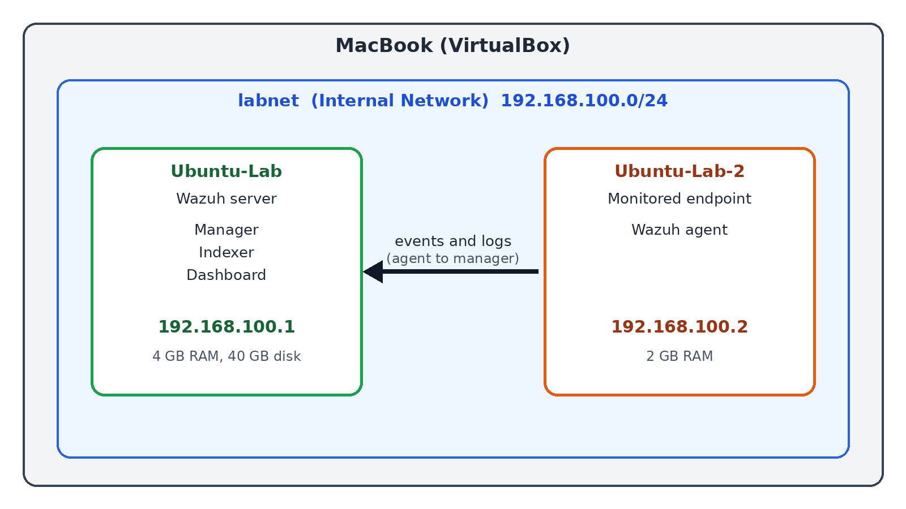
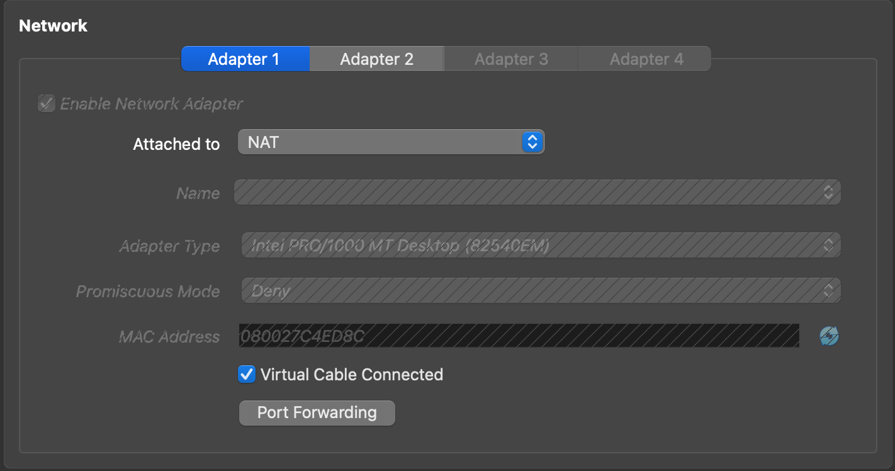
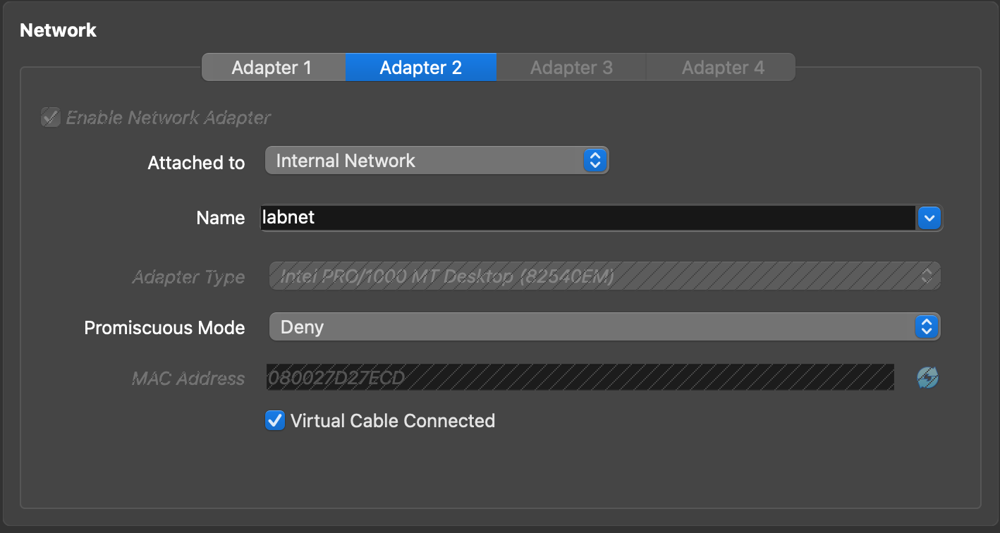
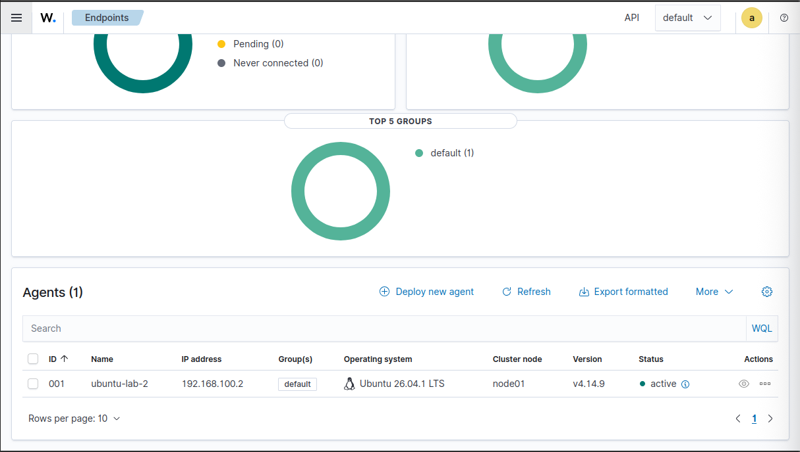
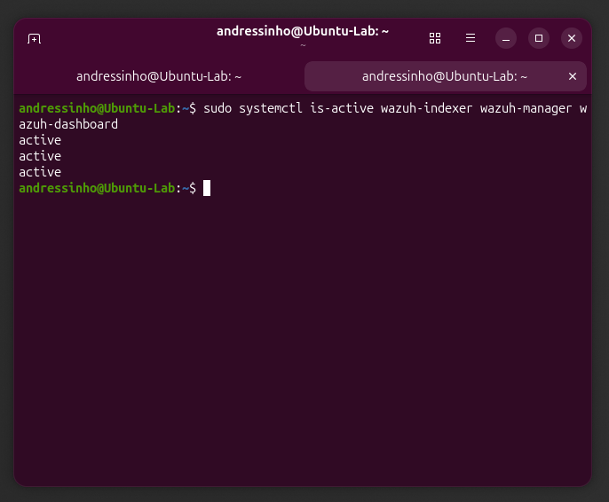
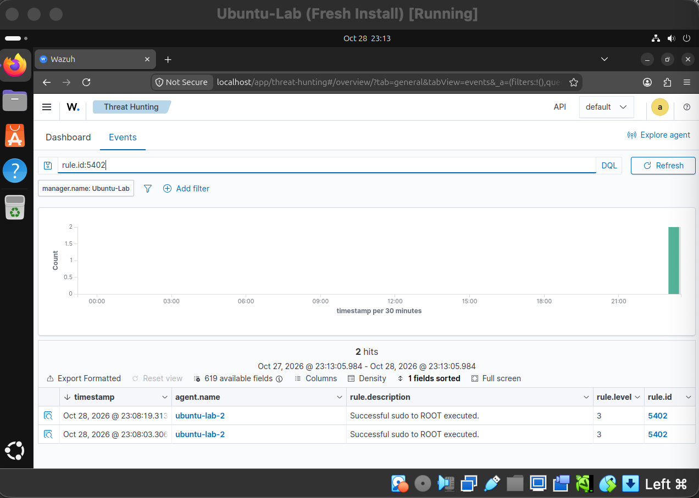
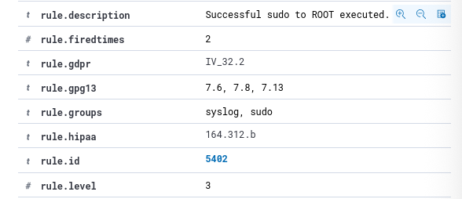
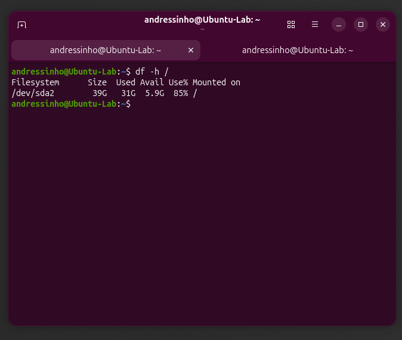

# Home SIEM Lab with Wazuh

I built a small SIEM lab on my MacBook using Wazuh and two Ubuntu VMs in VirtualBox. I wanted hands-on experience with detecting and investigating events the way a SOC analyst would before applying for security operations roles. One VM runs the Wazuh SIEM server, and the other is a monitored endpoint that sends its logs to it.

## Architecture

| VM | Role | Address |
|---|---|---|
| Ubuntu-Lab | Wazuh server (manager, indexer, dashboard), 4 GB RAM, 40 GB disk | 192.168.100.1 |
| Ubuntu-Lab-2 | Monitored endpoint running the Wazuh agent, 2 GB RAM | 192.168.100.2 |

- Host: M3 MacBook Pro (8 GB RAM), VirtualBox 7.2.20 (ARM64)
- OS: Ubuntu 26.04.1 ARM64 on both VMs
- Software: Wazuh 4.14.9 (all-in-one install)
- Network: each VM has a NAT adapter for internet access and an Internal Network adapter (`labnet`) for lab traffic

## Result: the agent is connected and reporting

## Test: detecting privileged command use

On the endpoint I ran `sudo ls /root` twice. Wazuh detected both as rule 5402, "Successful sudo to ROOT executed" (level 3, groups: syslog, sudo).

## Problem I solved: install failing with a full disk

The main issue I was running into was the Wazuh install failing partway through. The last attempt ended with “Wazuh dashboard installation failed,” and I watched free disk space on the server drop to zero while it ran. I first checked memory with `free -h` and added a 4 GB swap file, but memory wasn’t the problem. The cause was disk space. On first start, the Wazuh manager unpacks a vulnerability database of over 7.6 GB into `/var/ossec/tmp`, and that filled my 24 GB virtual disk completely. I used Claude Code to help track it down and then grew the disk to 40 GB. After that the install finished, the dashboard loaded, all three services were active, and the agent connected.

## What I learned

- How to build a two-VM lab in VirtualBox with a NAT adapter for internet access and an internal network for lab traffic.
- Check disk space before installing a SIEM, since Wazuh's vulnerability database alone needed more than 7 GB.
- I can create and set up VMs, read `df -h` output, and use `systemctl` to check whether a service is running.
- How a Wazuh agent reports to the server and how to find a specific event by its rule ID.

## Next steps

- Detect repeated failed SSH logins from the second VM.
- Add file integrity monitoring on a sensitive folder.
- Write a custom detection rule.
- Monitor disk usage on the server (it is at 85% on 40 GB).